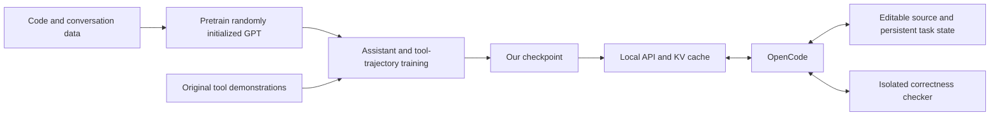

# The minimum agentic model: experiment notebook

The target is a small, scratch-trained model that can keep a real OpenCode session
going on simple tasks. This is not a claim of broad software-engineering skill.
We retain the 90,969,600-parameter model and o200k tokenizer. Its tied vocabulary
matrix accounts for 76,807,296 parameters, leaving 14,162,304 for the transformer
and normalization. The parameter headline alone overstates its reasoning capacity.

## Acceptance criteria

A successful demonstration must use the actual model and real OpenCode, with no
scripted model replies or injected solutions. For the narrow arithmetic-function
domain, require:

- At least 16 evolving requirements with cumulative independent Python tests.
- Correct real read/edit/check calls, not merely well-formed JSON.
- A deliberately failed checker call followed by successful recovery.
- A fresh session halfway through, recovering requirements from a state file.
- Earlier functions preserved through the final round.
- A clean end to each assistant turn, without an API error or output-limit loop.
- Repetition of the evaluation with fresh task seeds.
- A separate short-task regression suite retained after long-session training.

The state file in this evaluation is maintained by the harness. It is not evidence
that the model can write a faithful compaction summary itself. Graders run outside
the editable workspace in networkless containers. Training uses original simulated
tools, and the executable reference checks cover only our own bounded templates.
No downloaded or model-generated code executes directly on the host.

## Which component does what?



| Component | Minimum responsibility |
|---|---|
| Model | Choose an action, copy its arguments, produce the requested simple code, respond to observations |
| Training data | Show complete action/result histories in the actual interface format, with held-out task groups |
| Server | Preserve role/tool IDs, validate calls, enforce context/output limits, separate thinking from actions |
| Inference | Correct causal attention and KV caching; Flash Attention limits memory costs |
| OpenCode | Execute tools, provide file contents, manage sessions and context, display responses |
| Persistent task state | Recover requirements after history is replaced or a session restarts |
| Independent evaluator | Execute tests, detect lost requirements, record failures without trusting the model's claims |

Tool execution is outside the model. The server never executes generated Python or
shell commands. A context allocation limit is not evidence of effective context
use. Thinking text is not evidence of correct reasoning. Neither requirement is
hidden inside the label “agentic-ready.”

## Gotchas observed so far

### Teacher-forced loss does not establish agent success

Several checkpoints achieved very low supervised loss while failing actual tasks.
Packed long episodes contain many predictable tokens. A mistake in one identifier,
closing tag, or initial action can invalidate the whole rollout. We keep both loss
metrics and independent generated-action evaluations, and preserve a known working
checkpoint while experimenting.

### Check the reasoning mode before declaring all skills forgotten

The recovery checkpoint scored 0/8 arithmetic repairs using the default medium
reasoning mode. A raw wire capture showed an unclosed `<think>` followed by a
malformed tool delimiter. The parser correctly dispatched no action but previously
returned an empty-looking reply. With reasoning effort explicitly set to `none`,
the same weights scored 8/8 and completed the first cumulative-session task.

That is a protocol/mode failure, not evidence that the weights lost every repair
skill. Unclosed thinking that ends at EOS now reports a non-retryable error;
truncation at the output budget remains distinguishable. Direct action is the
baseline for the minimal agent. Optional thinking is a separate experiment.

### The real harness is part of the input distribution

Our first schema capture retained read/edit/check only. Real OpenCode also offered
write under its edit permission. Tool ordering, environment metadata, quoted CLI
messages, end-of-file annotations, and the checker's `PASS\nPASS\n` output differed
from simulated examples. These small textual differences mattered to this model.
The capture tool now retains all offered schemas; the wire-aligned curriculum
includes these observed formats with varying task values and workspace paths.

A counterfactual removal of the read footer changed a repeated read into an edit,
but the edit was still malformed. This isolates one contributor without claiming
that the footer was the only problem.

### Avoid accidental correlations in synthetic data

One early generator associated reasoning modes with exercise families. Another
used only none/low effort for short repairs while long tasks used all four modes.
Those shortcuts were not intended behavior. Tests now require mode coverage within
families. Pairs and handoff variants share a split group; exact duplicates are
removed. New task seeds alone do not prove generalization to new task families.

### Soft step limits are not a hard action budget

One OpenCode run configured for 12 steps made 104 repeated reads. The server now
stops three repetitions of an unchanged action/observation cycle of one to three
actions before further inference. This also catches alternating read/edit loops.
A changed observation or new user message breaks the match. This contains observed
loops; it does not teach recovery or detect every cycle.

A later run exposed a bypass: OpenCode appends a plain assistant message announcing
its step limit after the tool result. That hid the final action/result pair from
the first guard. A scripted client self-test reproduced this independently of the
model. The guard now skips plain assistant messages while scanning for repeated
actions, while a real user turn still resets it. Scripted guard tests are not model
capability results.

### A 5xx can make a bad generation much more expensive

Malformed tool output originally returned HTTP 502, encouraging the client to retry
the same deterministic failure. It now returns non-retryable HTTP 422 with a clear
error type. Invalid calls remain undispatched. API errors, wrong answers and failed
tests must be reported separately.

## Current experiment

`horizon-wire-v1` uses the captured four-tool interface, actual observation formatting,
quoted CLI requests, and direct actions. It keeps random task values and diverse
identifiers from the existing coding corpus. No evaluation solutions are imported.
The step-250 checkpoint completed 16/16 rounds (65 tool calls) with seed 849723,
including the transient checker failure and fresh-session handoff. Repeats exposed
remaining failures: seed 1337 passed 15/16; seed 20261004 passed 21/32, stopping
after two consecutive failures. It retained 8/8 short arithmetic repairs but
passed 0/4 broader repairs. These are development evaluations; improvements informed
by their failures need additional fresh seeds before a final capability claim.
The successful run reported 397,216 cached input tokens across 81 model responses,
13,821 uncached input tokens, and a largest prompt of 10,534 tokens. Those are
observed cache-use figures, not a measured wall-clock speedup or a 32K retrieval score.
Broader four-task repairs, reasoning tests and long-context
retrieval remain separate capability measurements, not prerequisites silently
redefined to make the narrow demonstration pass.

### Recovery examples must not reward the mistake

One failed rollout duplicated the previous function instead of adding the requested
one, then repeatedly attempted an ambiguous edit. The next curriculum includes
that error state and the correct repair. Deliberately wrong assistant actions carry
`supervise: false`: they remain visible as history, but their tokens receive no
training loss. Tool observations are always masked. This is supervised recovery
training, not reinforcement learning or evidence of general self-correction.

### Passing tests is not the same as finishing the turn

An early clean-recipe snapshot made a correct edit and called check successfully,
then kept editing and exhausted its output budget. The evaluator previously counted
only final code correctness and an observed passing check. It now also requires a
final `stop` event and no client error. Reinspection confirms that all 16 rounds of
the earlier successful wire-format run meet this stricter condition.

### Testing the minimum training sequence

`agent-minimal-v1` starts directly from our scratch-trained foundation, avoiding
the accumulated experimental SFT checkpoints. Its prepared corpus has 13,063 training
and 737 validation episodes, with 5,558,804 supervised training tokens. It combines
original wire-format arithmetic repairs, cumulative sessions and handoffs, masked
edit-error recovery, and 1,879 training conversations from SmolTalk. Two hundred
overlength/empty episodes were excluded rather than cut midway through a tool call.
The foundation already saw the mixed code/conversation/multilingual pretraining
corpus. This smaller SFT corpus does not establish conversational quality.

The tested route should ultimately require only random initialization → pretraining
→ one assistant/tool SFT stage → serving → independent OpenCode evaluation.
Whether this clean SFT matches the longer experimental lineage is being measured.

Reproduce this experiment after the foundation and source preparation in
[the training runbook](training-plan.md). Run from the repository root, with the
existing `data` symlink pointing inside the authorized NAS dataset directory.
All output paths below must be fresh:

```sh
.venv/bin/python scripts/capture_opencode_tools.py --out data/opencode-tools-v2.json
.venv/bin/python -m microgpt.grounding --tools data/opencode-tools-v2.json \
  --out data/grounding-wire-v1.jsonl --wire --effort none
.venv/bin/python -m microgpt.horizon_data --tools data/opencode-tools-v2.json \
  --out data/horizon-wire-v2.jsonl --vocabulary-data data/magicoder-large.jsonl \
  --count 2000 --wire --effort none --recover-errors
.venv/bin/python -m microgpt.trajectories --input data/horizon-wire-v2.jsonl \
  data/grounding-wire-v1.jsonl data/smoltalk-large.jsonl --out data/agent-minimal-v1 \
  --tokenizer data/large-v1 --max-length 32768 --limit 14000 --pack-episodes
.venv/bin/python -m microgpt.finetune --data data/agent-minimal-v1 \
  --out runs/agent-minimal-v1 --checkpoint runs/coding-v1/foundation/last.pt \
  --steps 6000 --accumulation 2 --lr 0.0001 --eval-every 250 --eval-examples 16 \
  --device cuda --attention flash --max-length 32768 --balanced-sources \
  --balanced-lengths --short-replay 0.2 \
  --sources horizon-session horizon-handoff grounding-read grounding-edit \
  --max-seconds 1800
```

Freeze the selected checkpoint before evaluating; training replaces `best.pt`
atomically, so a hard link preserves the exact evaluated file on this filesystem.
Record its step, parent, tokenizer fingerprint and SHA-256. Serve with a matching
4,096-token output budget, then run the actual client:

```sh
cp --reflink=auto runs/agent-minimal-v1/best.pt runs/agent-minimal-v1/candidate.pt
sha256sum runs/agent-minimal-v1/candidate.pt
.venv/bin/python -m microgpt.serve --checkpoint runs/agent-minimal-v1/candidate.pt \
  --device cuda --attention flash --port 8000 --max-output 4096
# In another terminal; select fresh result directories and repeat with new seeds.
.venv/bin/python scripts/eval_horizon.py --out runs/minimal-horizon-eval \
  --label 'frozen checkpoint identifier' --effort none --rounds 16 --seed 849723
.venv/bin/python scripts/eval_opencode.py --out runs/minimal-grounding-eval \
  --label 'same checkpoint identifier' --effort none --suite grounding
```

The horizon report includes cached-token counts and the largest observed prompt.
A 16-round success does not establish effective use of all 32K positions. Automatic
compaction, model-written handoff notes, unfamiliar tool sets, deep reasoning, and
general coding remain separate capabilities needing separate training and tests.

The direct recipe's early checkpoints did not yet reproduce the successful longer
lineage: step 750 failed after several rounds, step 1500 duplicated an identifier,
and the best-loss snapshot near step 3000 made malformed edit anchors. The recorded
failures are useful evidence against selecting checkpoints by loss alone.

An additional controlled variant adds a short visible plan immediately before each
correct edit: identify the new function and required expression, then preserve the
old code while building tool arguments. `horizon_data --action-plans` produces these
targets; the supplied requirements and tool results remain unchanged. This tests
whether explicit intermediate intent improves copying. It is not evidence of deep
reasoning, and its benefit must be established by complete generated rollouts.

That visible-plan variant failed both initial evaluation rounds even after 2,500
updates: it stated a plan and stopped without editing. It is retained as an
optional experiment, not enabled in the baseline. Likewise, replacing opaque
runtime tool IDs with training-shaped IDs did not fix the step-5000 failure.

The direct 6,000-step run completed the first eight rounds but failed after the
fresh-session boundary. Inspection exposed another input mismatch: synthetic
handoffs announced “Continue after a session handoff,” while actual fresh sessions
received an ordinary request plus the state file. Wire-format generation now uses
the same request/state-file formatter as the lesson harness, with independently
generated task instances. It no longer relies on that extra handoff announcement.

`agent-lines-v2` combines this correction with smaller edit targets: use a unique
final source line as the append anchor, falling back to the final function when
the line is ambiguous. Existing code need not be copied back in full. Recovery
examples still include duplicated-function failures. This changes the taught edit
strategy; the server does not repair model arguments or insert code for it.

The early smaller-edit candidate still failed at handoff by using the correct new
expression with an earlier function's identifier. The data audit found that most
training functions had distinct word prefixes; the evaluation's sibling functions
all share a prefix and differ in their numeric suffix. The `--related-names`
curriculum adds same-prefix siblings in half of sessions, balanced independently
of the error-recovery pattern. Prefixes still come from the existing vocabulary;
evaluation identifiers, values and solutions are not inserted into training.
